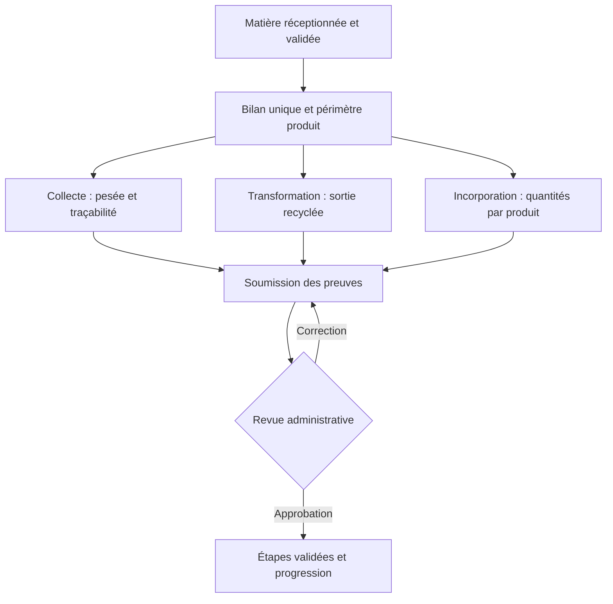

<div align="center">

# TexTileCycle

**La seconde vie du textile devient visible**

Plateforme de circularité textile, de passeports numériques et de préparation aux labels.

**[Découvrir l’application déployée](https://textilecycle.onrender.com/)** · **[Scénario matières → labels](docs/circular-material-label-journey.md)** · **[Captures de production](docs/screenshots/README.md)**

Projet **Applications Web Avancées — ESPRIT · 5TWIN4 · TechForGood · 2026–2027**

`Laravel 12` · `PHP ≥ 8.2` · `Blade` · `Tailwind CSS 3` · `Alpine.js` · `PostgreSQL / MySQL`

</div>


## Sommaire

- [Présentation](#présentation)
- [Démonstration et captures](#démonstration-et-captures)
- [Rôles et fonctionnalités](#rôles-et-fonctionnalités)
- [Scénario complet : une matière contribue à une démarche label](#scénario-complet--une-matière-contribue-à-une-démarche-label)
- [Autres parcours métier](#autres-parcours-métier)
- [Fournisseurs, Impact ESG, recyclage et copilote IA](#fournisseurs-impact-esg-recyclage-et-copilote-ia)
- [Architecture et technologies](#architecture-et-technologies)
- [Installation locale](#installation-locale)
- [Configuration des services](#configuration-des-services)
- [Déploiement sur Render](#déploiement-sur-render)
- [Tests et qualité](#tests-et-qualité)
- [Organisation du dépôt](#organisation-du-dépôt)
- [Dépannage](#dépannage)
- [Contribution et crédits](#contribution-et-crédits)

## Présentation

TexTileCycle relie consommateurs, marques, collecteurs et administrateurs pour documenter le cycle de vie d’un textile : identification, composition, retour, collecte, transformation et incorporation dans de nouveaux produits.

Le projet répond à trois besoins :

1. **Comprendre un produit** grâce au catalogue et au Smart Scan de tickets, étiquettes, codes-barres ou QR codes.
2. **Organiser sa seconde vie** avec des programmes de réparation, don, reprise et recyclage, des points partenaires et des retours suivis.
3. **Construire un dossier vérifiable** en reliant les matières reçues aux produits, aux feuilles de route et aux preuves examinées par l’administration.

Les vues d’impact mettent en avant les ODD **6 — Eau**, **7 — Énergie**, **12 — Consommation et production responsables** et **13 — Climat**. Les valeurs de présentation de l’accueil illustrent l’expérience ; elles ne constituent pas un audit des résultats de production.

> TexTileCycle accompagne une préparation interne aux labels. Une réception de matière, un score ou une validation de preuves dans l’application ne délivre aucune certification et n’autorise pas l’usage d’un logo de label.

## Démonstration et captures

**Application : [https://textilecycle.onrender.com/](https://textilecycle.onrender.com/)**

Les **39 captures** de cette documentation ont été prises dans un navigateur sur la version réellement déployée, le **8 octobre 2026** : **5 vues publiques, 14 administrateur, 9 marque et 11 consommateur**. Les trois comptes de démonstration ont été ouverts avec autorisation. Aucun formulaire métier n’a été soumis pour produire cette galerie.

Ces captures attestent de l’état affiché, pas d’un test complet des intégrations ni du SHA exécuté par Render. Les listes vides, médias de remplacement et recommandations déterministes restent visibles tels qu’observés. [Consulter les pages, dates et limites de la galerie](docs/screenshots/README.md).

### Un cycle textile documenté


### Connexion


### Inscription consommateur


### Entrée du parcours marque

Le choix « Marque » ouvre un questionnaire en six étapes et annonce la validation administrative nécessaire avant l’accès au compte.


### Espace consommateur

Comprendre les produits, scanner un textile, préparer un retour et suivre les récompenses.

<details>
<summary>Accueil et impact personnel</summary>


[Page de l’application](https://textilecycle.onrender.com/discover) · Connexion avec le rôle correspondant requise.

</details>

<details>
<summary>Catalogue des vêtements</summary>


[Page de l’application](https://textilecycle.onrender.com/discover/products) · Connexion avec le rôle correspondant requise.

</details>

<details>
<summary>Solutions circulaires</summary>


[Page de l’application](https://textilecycle.onrender.com/discover/programs) · Connexion avec le rôle correspondant requise.

</details>

<details>
<summary>Points de collecte</summary>


[Page de l’application](https://textilecycle.onrender.com/discover/points) · Connexion avec le rôle correspondant requise.

</details>

<details>
<summary>Historique des scans</summary>


[Page de l’application](https://textilecycle.onrender.com/scans) · Connexion avec le rôle correspondant requise.

</details>

<details>
<summary>Liste des retours et statuts</summary>


[Page de l’application](https://textilecycle.onrender.com/product-returns) · Connexion avec le rôle correspondant requise.

</details>

<details>
<summary>Wallet et récompenses</summary>


[Page de l’application](https://textilecycle.onrender.com/discover/wallet) · Connexion avec le rôle correspondant requise.

</details>

<details>
<summary>Smart Scan — formulaire non soumis</summary>


[Page de l’application](https://textilecycle.onrender.com/scans/create) · Connexion avec le rôle correspondant requise.

</details>

<details>
<summary>Passeport produit — Hemp Denim 2030</summary>


[Page de l’application](https://textilecycle.onrender.com/discover/products/6) · Connexion avec le rôle correspondant requise.

</details>

<details>
<summary>Déclaration de retour — formulaire non soumis</summary>


[Page de l’application](https://textilecycle.onrender.com/product-returns/create) · Connexion avec le rôle correspondant requise.

</details>

<details>
<summary>Résultat du traitement — retour terminé</summary>


[Page de l’application](https://textilecycle.onrender.com/product-returns/2) · Connexion avec le rôle correspondant requise.

</details>

### Espace marque — Brand Studio

Gérer le catalogue, consulter les labels et relier les besoins en matières aux retours compatibles. L’analyse produit-label capturée indique explicitement son mode déterministe.

<details>
<summary>Pilotage de la marque</summary>


[Page de l’application](https://textilecycle.onrender.com/brand) · Connexion avec le rôle correspondant requise.

</details>

<details>
<summary>Catalogue de la marque</summary>


[Page de l’application](https://textilecycle.onrender.com/brand/products) · Connexion avec le rôle correspondant requise.

</details>

<details>
<summary>Import CSV — formulaire non soumis</summary>


[Page de l’application](https://textilecycle.onrender.com/brand/products/import) · Connexion avec le rôle correspondant requise.

</details>

<details>
<summary>Labels et démarches</summary>


[Page de l’application](https://textilecycle.onrender.com/brand/labels) · Connexion avec le rôle correspondant requise.

</details>

<details>
<summary>Feuilles de route — état vide</summary>


[Page de l’application](https://textilecycle.onrender.com/brand/roadmaps) · Connexion avec le rôle correspondant requise.

</details>

<details>
<summary>Recommandations produit-label — analyse déterministe</summary>


[Page de l’application](https://textilecycle.onrender.com/brand/product-label-recommendations) · Connexion avec le rôle correspondant requise.

</details>

<details>
<summary>Demandes de matières — formulaire non soumis</summary>


[Page de l’application](https://textilecycle.onrender.com/brand/material-requests) · Connexion avec le rôle correspondant requise.

</details>

<details>
<summary>Retours compatibles et seconde vie</summary>


[Page de l’application](https://textilecycle.onrender.com/brand/material-matches) · Connexion avec le rôle correspondant requise.

</details>

<details>
<summary>Profil public de la marque</summary>


[Page de l’application](https://textilecycle.onrender.com/brand/profile) · Connexion avec le rôle correspondant requise.

</details>

### Espace administrateur

Piloter les statistiques, le catalogue, la collecte et la préparation aux référentiels. Les inscriptions, collecteurs et feuilles de route présentent ici leur état vide réel.

<details>
<summary>Centre de pilotage</summary>


[Page de l’application](https://textilecycle.onrender.com/admin) · Connexion avec le rôle correspondant requise.

</details>

<details>
<summary>Produits et publications</summary>


[Page de l’application](https://textilecycle.onrender.com/products) · Connexion avec le rôle correspondant requise.

</details>

<details>
<summary>Référentiel des matières</summary>


[Page de l’application](https://textilecycle.onrender.com/materials) · Connexion avec le rôle correspondant requise.

</details>

<details>
<summary>Historique Smart Scan</summary>


[Page de l’application](https://textilecycle.onrender.com/scans) · Connexion avec le rôle correspondant requise.

</details>

<details>
<summary>Propositions de passeport</summary>


[Page de l’application](https://textilecycle.onrender.com/admin/passport-proposals) · Connexion avec le rôle correspondant requise.

</details>

<details>
<summary>Détections</summary>


[Page de l’application](https://textilecycle.onrender.com/detections) · Connexion avec le rôle correspondant requise.

</details>

<details>
<summary>Programmes de reprise</summary>


[Page de l’application](https://textilecycle.onrender.com/recovery-programs) · Connexion avec le rôle correspondant requise.

</details>

<details>
<summary>Points de collecte</summary>


[Page de l’application](https://textilecycle.onrender.com/collection-points) · Connexion avec le rôle correspondant requise.

</details>

<details>
<summary>Comptes collecteurs — état vide</summary>


[Page de l’application](https://textilecycle.onrender.com/admin/collectors) · Connexion avec le rôle correspondant requise.

</details>

<details>
<summary>Résultats de traitement</summary>


[Page de l’application](https://textilecycle.onrender.com/treatment-results) · Connexion avec le rôle correspondant requise.

</details>

<details>
<summary>Inscriptions marques — état vide</summary>


[Page de l’application](https://textilecycle.onrender.com/admin/brand-applications) · Connexion avec le rôle correspondant requise.

</details>

<details>
<summary>Feuilles de route — état vide</summary>


[Page de l’application](https://textilecycle.onrender.com/admin/roadmaps) · Connexion avec le rôle correspondant requise.

</details>

<details>
<summary>Catalogue des labels</summary>


[Page de l’application](https://textilecycle.onrender.com/admin/labels) · Connexion avec le rôle correspondant requise.

</details>

<details>
<summary>Évaluations de préparation</summary>


[Page de l’application](https://textilecycle.onrender.com/assessments) · Connexion avec le rôle correspondant requise.

</details>

## Rôles et fonctionnalités

| Rôle | Responsabilités principales |
| --- | --- |
| **Consommateur** | Consulter le catalogue, identifier un textile, confirmer les informations du scan, suivre son passeport, déclarer un retour et un dépôt avec photo, consulter les points et la seconde vie déclarée. |
| **Marque** | Compléter son onboarding, gérer ses produits et compositions, soumettre les passeports, publier des besoins en matières, réserver et réceptionner des textiles compatibles, documenter leur transformation et constituer les preuves de ses feuilles de route. |
| **Fournisseur** | Gérer son espace, ses commandes, livraisons, lots et certificats ; répondre aux demandes de recyclage et suivre les actions à traiter. |
| **Collecteur** | Contrôler le dépôt, le QR, l’état et la pesée ; documenter la remise des textiles du centre vers la marque. |
| **Administrateur** | Examiner les inscriptions, retenir les labels proposés, vérifier les produits et passeports, contrôler les matières et preuves, approuver les étapes ou demander une correction et consulter les statistiques. |

Les ateliers, associations et recycleurs interviennent comme partenaires du parcours circulaire et points de collecte. Ils ne sont pas tous des rôles de connexion distincts.

### Principaux modules

| Module | Fonctionnement |
| --- | --- |
| **Catalogue et passeports** | Recherche et filtres, fiche produit, composition, origine, réparabilité, réemploi et consignes de fin de vie. Les données absentes sont indiquées comme non renseignées. |
| **Smart Scan** | OCR, lecture de codes, recherche manuelle, suggestions IA facultatives et confirmation humaine. Historique des scans et contrôle des passeports proposés. |
| **Collecte et retours** | Programmes, points partenaires, déclaration, photos privées, contrôle QR, pesée, résultats et suivi des récompenses. |
| **Échange de matières** | Besoins des marques, compatibilité, réservation, transfert, réception et contrôle final avant attribution des points. |
| **Brand Studio** | Produits en brouillon, composition à 100 %, soumission et revue, versions, import CSV, duplication, archivage et profil de marque. |
| **Orientation produit-label** | Règles déterministes versionnées, explications IA facultatives et création d’une feuille de route depuis une recommandation retenue. |
| **Feuilles de route** | Périmètre de produits, étapes, responsables, échéances, actions, résultats et pièces privées avec revue administrative. |
| **Dossiers documentaires** | Preuves versionnées et pondérées, commentaires, historique et score distinct de celui des feuilles de route. |
| **Espace fournisseurs** | Invitations avec activation de compte, lots et certificats, commandes, performance OTIF, alertes d’expiration et indicateurs de risque. |
| **Impact ESG** | Rapports d’impact, simulation de composition, objectifs carbone avec leviers matière et analyse des allégations environnementales. |
| **Recyclage fournisseur** | Demandes de recyclage, estimation et recalcul des coûts, proposition du fournisseur, suivi de transformation, facture ou avoir et collectes programmées. |
| **Copilote IA** | Assistant de marque avec outils en lecture seule pour interroger risques, certificats, commandes, impacts, objectifs carbone et recyclage. |

## Scénario complet : une matière contribue à une démarche label

La réception crée un **bilan matière traçable**. La progression vers un label résulte ensuite de l’approbation des étapes documentées.

### Déroulement par acteur

| Étape | Acteur | Action et résultat |
| --- | --- | --- |
| **1. Préparer** | Marque | Choisir un label retenu, définir les produits concernés, la situation initiale et l’objectif, puis créer une feuille de route. |
| **2. Exprimer le besoin** | Marque | Depuis l’étape de collecte, publier une demande : matière, pureté, états acceptés, quantité recherchée et bonus de points. La demande conserve le périmètre et sa version. |
| **3. Déposer** | Consommateur | Identifier le textile, confirmer ses informations, obtenir le passeport validé si nécessaire, déclarer le retour dans un point autorisé et joindre une photo de dépôt. |
| **4. Contrôler** | Collecteur et admin | Confirmer QR, photo, état et poids réel ; vérifier la matière avant sa proposition aux marques. |
| **5. Réserver et transférer** | Marque et collecteur | Réserver une proposition compatible. Pour un textile déjà au centre, le collecteur prouve sa remise à la marque avec le code de transfert, une photo et une note. |
| **6. Réceptionner** | Marque | Confirmer la réception puis le contrôle final. L’échange validé attribue les points une seule fois et crée la matière en stock. |
| **7. Affecter** | Marque | Associer la matière à un seul périmètre de feuille de route compatible. L’association peut provenir de la demande si sa version est toujours valide. |
| **8. Transformer** | Marque | Documenter l’envoi au partenaire, la sortie recyclée puis les quantités incorporées aux produits, avec descriptions et justificatifs privés. |
| **9. Soumettre** | Marque | Préparer les preuves des étapes depuis le bilan, compléter les actions et résultats par produit, puis soumettre à la revue. |
| **10. Examiner** | Admin | Approuver les preuves ou demander une correction. Seules les étapes approuvées augmentent la progression. |
| **11. Suivre** | Consommateur | Consulter séparément sa récompense et la seconde vie déclarée, sans accéder aux documents internes de production. |



### Exemple chiffré

Une marque recherche **50 kg**. Un retour apporte **10 kg pesés** ; le partenaire produit **8 kg recyclés**, dont **7 kg** sont incorporés dans le produit du plan.

| Indicateur | Valeur | Interprétation |
| --- | --- | --- |
| Entrée physique | 10 kg | Quantité réceptionnée et pesée. |
| Sortie recyclée | 8 kg | Résultat documenté de la transformation. |
| Incorporation | 7 kg | Quantité réellement affectée aux produits couverts. |
| Progression d’un plan à 7 étapes | 43 % | Trois étapes approuvées sur sept, après revue. |

Ces quantités restent **10 / 8 / 7 kg** si plusieurs étapes référencent le même bilan. Elles ne deviennent pas 25 kg de collecte. Les récompenses suivent les règles du retour et de la demande, séparément de la progression label.

### Règles de cohérence

- Un textile réservé ne peut pas être réservé une seconde fois ; les réservations tiennent compte du besoin restant.
- La réception ne peut pas précéder la remise documentée. Le mode `hub_transfer` ne demande pas un second dépôt au consommateur ; le mode `consumer_transfer` suit un transfert direct distinct.
- Une pesée estimée ne suffit pas pour la preuve de collecte d’une feuille de route.
- La sortie recyclée ne dépasse pas l’entrée ; l’incorporation totale ne dépasse pas la sortie recyclée.
- Une matière est affectée intégralement à un seul périmètre. Le fractionnement entre plusieurs plans n’est pas proposé.
- Une correction conserve l’historique et remet les étapes concernées en revue ; elle ne modifie pas silencieusement une approbation.
- Après affectation, un nouveau périmètre exige une autre feuille de route. L’archivage conserve l’historique et bloque les nouvelles actions jusqu’à restauration.

**Progression d’une feuille de route :** `étapes approuvées / nombre total d’étapes × 100`.

Le tableau de bord label utilise la moyenne des plans actifs. Le score pondéré d’un dossier documentaire général reste un indicateur distinct. Un dossier à 100 % peut porter le statut interne `verified_evidence` (« Preuves vérifiées ») ; il ne devient pas une certification officielle.

→ [Scénario détaillé, exceptions et règles de traçabilité](docs/circular-material-label-journey.md).

## Autres parcours métier

### Smart Scan et passeport proposé

1. Analyser le ticket ou l’étiquette avec l’OCR local et la lecture de codes ; Gemini peut compléter les champs encore vides.
2. Faire corriger et confirmer les informations par le consommateur.
3. Soumettre le passeport à TexTileCycle : approbation, refus ou demande de complément.
4. Faire valider ou corriger par la marque lorsqu’elle est identifiée.
5. Publier le passeport et ouvrir le retour circulaire après les validations nécessaires.
6. Documenter le dépôt et le contrôle du collecteur.

Le ticket, le prix, l’enseigne et la date d’achat ne sont pas exposés à la marque. Les tickets et preuves sont servis par des accès authentifiés.

### Onboarding marque

Le questionnaire comporte six étapes : **compte, périmètre, matières, origine animale, environnement et preuves**. Les questions conditionnelles sont également contrôlées côté serveur.

Après l’envoi, le compte reste en attente et déconnecté. L’administrateur examine les déclarations, les pistes IA et les pièces ; il retient les labels, motive sa décision et active le compte. L’analyse originale et la sélection finale restent séparées. L’activation programme les emails de notification et de traçabilité. La marque retrouve les démarches retenues dans **Mes labels**.

### Publication des produits

Une marque crée un brouillon puis le soumet. L’administrateur vérifie et publie ou demande une correction. Modifier un produit publié crée une nouvelle version et le remet en brouillon. La marque ne publie pas directement.

L’import CSV exige `name`, `sku` et `category`. Les lignes importées restent en brouillon :

```csv
name,sku,category,description,origin,barcode,recyclability_score,recycling_instructions
T-shirt circulaire,TS-001,T-shirt,Description,Tunisie,6190000000001,85,Réemploi puis collecte
```

## Fournisseurs, Impact ESG, recyclage et copilote IA

Ces modules prolongent le parcours circulaire avec des outils destinés aux marques, à leurs fournisseurs et à l’administration.

### Espace fournisseurs

- La marque peut inviter un fournisseur et lui envoyer un lien d’activation pour créer son propre accès.
- Le fournisseur gère ses commandes, lots et certificats depuis son espace. L’analyse d’un certificat extrait les informations disponibles et indique le modèle utilisé.
- La marque suit la performance des livraisons (OTIF), les facteurs de risque et les échéances des certificats. Les alertes peuvent être envoyées aux comptes concernés.
- Les commandes prennent en charge les réponses et contre-propositions du fournisseur ainsi que le suivi des livraisons.

### Impact ESG

- Les rapports présentent les impacts calculés des produits, dont les émissions de CO₂e et la consommation d’eau.
- Le simulateur permet de comparer une composition alternative sans modifier le rapport enregistré.
- Les objectifs carbone associent un budget et une échéance à des produits et volumes prévus ; des leviers de composition permettent d’en recalculer l’impact.
- L’analyse anti-greenwashing classe les allégations et propose des corrections. Les règles restent disponibles lorsque les modèles externes ne le sont pas.

### Recyclage fournisseur

- Une marque soumet des articles ou des chutes à recycler ; l’analyse d’image peut suggérer une fibre et des défauts visibles. La reconnaissance CLIP s’exécute dans le navigateur.
- Le coût est estimé à partir du type de matière, des quantités et des opérations. Il est recalculé avec la proposition du fournisseur puis les quantités réellement produites.
- Le parcours suit la réception, la transformation, la livraison de matière recyclée ou le rachat. Les pièces générées comprennent une facture ou, selon le mode choisi, un avoir.
- Les collectes récurrentes peuvent être programmées, mises en pause et lancées ; l’administration dispose d’une vue des flux et de leur état.

### Copilote IA

Le copilote répond aux questions de la marque en s’appuyant sur des outils qui lisent ses données : risques fournisseurs, certificats, commandes, performance OTIF, impacts produit, objectifs carbone, bilan de recyclage et analyse d’allégations. Les outils ne modifient pas les données. Si le service Hugging Face n’est pas configuré ou est indisponible, les modules concernés utilisent leurs mécanismes locaux lorsqu’ils en disposent.

### Configurer Hugging Face (facultatif)

Ajouter le jeton uniquement au fichier `.env` local ou aux variables d’environnement du serveur :

```env
HF_AI_ENABLED=true
HF_TOKEN=<jeton_serveur>
```

Sans `HF_TOKEN`, les fonctionnalités compatibles restent en mode local. Les modèles peuvent être ajustés avec les variables `HF_VLM_MODELS`, `HF_CHAT_MODELS`, `HF_CLAIMS_MODEL`, `HF_SPECIFICITY_MODEL` et `HF_ZERO_SHOT_MODEL`. Ne jamais exposer le jeton dans le navigateur ni le committer.

Pour vérifier le jeton et tester les services IA configurés :

```bash
php artisan huggingface:check
```

Les alertes d’expiration des certificats sont planifiées à 8 h et les collectes récurrentes à 7 h 30. En développement, démarrer le planificateur Laravel avec `php artisan schedule:work` ; en production, s’assurer que le planificateur est exécuté régulièrement.

## Architecture et technologies

| Couche | Technologies et responsabilités |
| --- | --- |
| **Serveur** | Laravel 12, PHP ≥ 8.2, Eloquent, validation, contrôleurs, services métier et contrôle des rôles. |
| **Interface** | Blade, Breeze, Tailwind CSS 3, Alpine.js, Chart.js ; thèmes clair et sombre. |
| **Assets** | Vite 7, Node.js et npm ; build reproductible avec `package-lock.json`. |
| **Données** | MySQL en local, PostgreSQL sur Render ; SQLite pour les tests. |
| **Médias** | Cloudinary en production ; stockage local configurable pour le développement et les preuves. |
| **Analyse** | Tesseract OCR, ZBar et ImageMagick ; Hugging Face, Gemini et OpenAI facultatifs selon le module. |
| **Asynchrone** | File Laravel en base de données, worker, notifications et emails SMTP. |
| **Exécution** | Docker multi-stage : assets Node 22, PHP 8.3, Apache et Supervisor. |
| **Validation** | PHPUnit 11, tests Laravel et workflow GitHub Actions. |

Les entités métier principales relient `Product` à `Material`, `Scan` à `Detection`, `RecoveryProgram` à `CollectionPoint`, et `ProductReturn` à ses preuves et résultats. L’échange relie demandes et propositions à un `MaterialUsage` unique ; ce bilan et ses événements alimentent les preuves des feuilles de route.

## Installation locale

### Prérequis

- PHP **8.2 ou supérieur**, Composer 2 et les extensions Laravel usuelles : Ctype, cURL, DOM, Fileinfo, Filter, Hash, Mbstring, OpenSSL, PCRE, PDO, Session, Tokenizer et XML.
- Le pilote PDO de la base choisie (`pdo_mysql`, `pdo_pgsql` ou `pdo_sqlite`) ; ZIP et BCMath comme dans l’image Docker.
- Node.js **22 LTS ≥ 22.12** et npm pour Vite 7.
- MySQL avec une base `textilecycle` en `utf8mb4`, ou une autre base configurée explicitement.
- Pour l’analyse locale d’images : Tesseract, ZBar et ImageMagick. L’image Docker les installe déjà.

Avec XAMPP, démarrer MySQL et créer la base dans phpMyAdmin. `php artisan serve` peut servir l’application sans utiliser Apache XAMPP.

### Installer et lancer

```bash
git clone https://github.com/walaeddine-riahi/Esprit-5twin4-TechForGood.git
cd Esprit-5twin4-TechForGood
composer install
cp .env.example .env
php artisan key:generate
npm ci
```

Le dépôt est privé : le clonage nécessite un accès GitHub autorisé. Configurer ensuite `.env` avant les migrations :

```env
APP_ENV=local
APP_DEBUG=true
APP_URL=http://127.0.0.1:8000
DB_CONNECTION=mysql
DB_HOST=127.0.0.1
DB_PORT=3306
DB_DATABASE=textilecycle
DB_USERNAME=root
DB_PASSWORD=
FILESYSTEM_DISK=public
PRODUCT_MEDIA_STORAGE=public
ROADMAP_PROOF_STORAGE=local
QUEUE_CONNECTION=database
DB_QUEUE_RETRY_AFTER=180
MAIL_MAILER=log
```

Les overrides de stockage ci-dessus permettent un démarrage local sans Cloudinary ; `.env.example` propose Cloudinary par défaut. Adapter l’utilisateur et le mot de passe MySQL à l’installation.

```bash
php artisan migrate
php artisan storage:link
npm run build
php artisan serve
```

Dans un second terminal, lancer le worker pour les analyses et notifications asynchrones :

```bash
php artisan queue:work --tries=3 --timeout=150
```

Ouvrir **http://127.0.0.1:8000**. Pour le développement avec rechargement des assets, utiliser `npm run dev` dans un autre terminal, ou `composer run dev` pour lancer serveur, worker, logs et Vite ensemble.

Sous PowerShell, remplacer `cp .env.example .env` par `Copy-Item .env.example .env`. Si PHP n’est pas dans le PATH, utiliser par exemple `C:\xampp\php\php.exe artisan migrate`.

### Données et comptes de démonstration locaux

Sur une base de développement, charger les données avec :

```bash
php artisan db:seed
```

| Profil | Adresse de démonstration | Mot de passe local |
| --- | --- | --- |
| Administrateur | `admin@textilecycle.test` | `password` |
| Marque | `brand@textilecycle.test` | `password` |
| Fournisseur | `fournisseur@textilecycle.test` | `password` |
| Consommateur | `consumer@textilecycle.test` | `password` |

Ces identifiants sont ceux des seeders locaux ; le compte fournisseur est créé pour les données de démonstration avancées. Les trois espaces de démonstration public documentés ont été ouverts sur Render le 8 octobre 2026. Le collecteur intervient dans le scénario et les tests ; cette table ne lui invente pas de compte de démonstration. Ne pas utiliser les comptes de seed en exploitation réelle.

## Configuration des services

### Stockage Cloudinary

En production, les médias doivent survivre aux redéploiements. Configurer :

```env
FILESYSTEM_DISK=cloudinary
PRODUCT_MEDIA_STORAGE=cloudinary
ROADMAP_PROOF_STORAGE=cloudinary
CLOUDINARY_URL=cloudinary://<api_key>:<api_secret>@<cloud_name>
CLOUDINARY_SECURE=true
```

Les variables séparées `CLOUDINARY_CLOUD_NAME`, `CLOUDINARY_API_KEY` et `CLOUDINARY_API_SECRET` peuvent remplacer `CLOUDINARY_URL`. Les tickets sont des ressources Cloudinary `authenticated` ; les URLs sont signées côté serveur. Les anciens chemins locaux encore présents restent lisibles, et un média perdu dispose d’un remplacement visuel.

Les preuves locales de feuilles de route nécessitent un disque privé persistant si ce mode est choisi en production.

### Smart Scan : Gemini facultatif

```env
GEMINI_AI_ENABLED=true
GEMINI_API_KEY=<cle_serveur>
GEMINI_MODEL=gemini-3.5-flash-lite
SMART_SCAN_ASYNC=false
```

Le modèle ci-dessus est la valeur configurée dans le dépôt ; sa disponibilité et ses quotas dépendent du fournisseur. Sans clé, en cas de quota ou d’erreur réseau, le parcours conserve l’analyse locale. Les suggestions complètent les champs vides sans écraser les données locales ou du catalogue et restent soumises à confirmation.

Pour déplacer l’analyse vers la file, définir `SMART_SCAN_ASYNC=true` et maintenir un worker actif. Le formulaire informe l’utilisateur du recours au service externe.

### Orientation marque et produit-label : OpenAI facultatif

```env
BRAND_AI_API_KEY=<cle_serveur>
BRAND_AI_MODEL=gpt-4o-mini
BRAND_AUDIT_EMAIL=audit@example.com
PRODUCT_LABEL_AI_API_KEY=<cle_serveur>
PRODUCT_LABEL_AI_MODEL=gpt-4o-mini
```

Sans clé d’onboarding, le dossier indique « IA non configurée » et reste disponible pour revue manuelle. L’admin peut relancer l’analyse après configuration. Les échecs sont tracés ; aucun résultat IA fictif n’est produit. Le questionnaire n’envoie pas l’email ou le mot de passe du compte à OpenAI.

L’analyse produit-label applique d’abord des règles déterministes versionnées. OpenAI peut enrichir les explications, mais ne modifie pas les décisions ou seuils des règles. Une recommandation acceptée peut préremplir la feuille de route et conserver un instantané de l’analyse.

### Emails et file de traitement

```env
MAIL_MAILER=smtp
MAIL_HOST=<hote_smtp>
MAIL_PORT=587
MAIL_USERNAME=<utilisateur_smtp>
MAIL_PASSWORD=<mot_de_passe_smtp>
MAIL_FROM_ADDRESS=notifications@example.com
MAIL_FROM_NAME=TexTileCycle
QUEUE_CONNECTION=database
DB_QUEUE_RETRY_AFTER=180
```

Configurer `MAIL_SCHEME` selon le transport du fournisseur. `MAIL_MAILER=log` écrit les emails dans les logs et ne les envoie pas. `DB_QUEUE_RETRY_AFTER` doit dépasser le timeout de 150 secondes du worker Docker.

Les clés restent côté serveur, dans `.env` ou dans les variables de Render. Ne pas les committer ni les exposer avec un préfixe `VITE_`.

## Déploiement sur Render

Le dépôt contient un `Dockerfile` et un démarrage dans `docker/start.sh`. Le build compile les assets puis installe les dépendances PHP de production. Supervisor maintient Apache et le worker.

### Variables essentielles

```env
APP_ENV=production
APP_DEBUG=false
APP_URL=https://textilecycle.onrender.com
APP_KEY=<cle_laravel_stable>
DB_CONNECTION=pgsql
DB_URL=<url_postgresql_persistante>
FILESYSTEM_DISK=cloudinary
PRODUCT_MEDIA_STORAGE=cloudinary
ROADMAP_PROOF_STORAGE=cloudinary
CLOUDINARY_URL=<configuration_cloudinary>
QUEUE_CONNECTION=database
DB_QUEUE_RETRY_AFTER=180
RUN_SEED=false
```

Ajouter les variables SMTP et les intégrations IA utilisées. Générer `APP_KEY` une fois avec `php artisan key:generate --show` et conserver la même clé entre déploiements.

### Démarrage de l’image

1. Vérifier `APP_KEY`, la connexion de base et Cloudinary ; refuser SQLite pour éviter une base éphémère.
2. Préparer les répertoires Laravel et leurs droits.
3. Mettre en cache la configuration et exécuter `php artisan migrate --force`.
4. Charger les données de démonstration uniquement si `RUN_SEED=true` est explicitement défini.
5. Compiler les vues, créer le lien de stockage et configurer le port fourni par Render, par défaut `10000`.
6. Démarrer Apache et le worker sous Supervisor.

La migration du parcours matières-labels est additive et se trouve dans `database/migrations/2026_10_08_000900_link_materials_to_label_roadmaps.php`.

Après un déploiement, vérifier les migrations, le fonctionnement du worker, l’envoi des emails et un parcours métier avec un compte autorisé. La disponibilité de l’accueil seule ne valide pas ces services.

## Tests et qualité

```bash
composer test
npm run build
php artisan view:cache
```

Les tests couvrent notamment l’onboarding, les produits, le Smart Scan, les passeports, la confidentialité des médias, l’échange de matières, les récompenses, l’orientation produit-label et les feuilles de route.

Le scénario circulaire vérifie les quatre rôles, les états, les bilans de masse, la double affectation, les corrections avec nouvelle revue et la double validation des points.

**Dernière validation locale de l’amélioration métier** — commit `6129149` : **92 tests réussis, 1 610 assertions**, build Vite et compilation Blade réussis. Ce résultat est un instantané de validation, pas un statut CI dynamique.

Le workflow [Application tests](.github/workflows/tests.yml) est configuré sur les pull requests et les mises à jour de `main`. Consulter l’onglet Actions pour connaître le résultat effectif de chaque exécution ; la présence du workflow ne garantit pas son démarrage.

## Organisation du dépôt

| Chemin | Contenu |
| --- | --- |
| `app/Models/` | Entités et relations Eloquent. |
| `app/Http/Controllers/` | Parcours administrateur, marque, consommateur et collecteur. |
| `app/Services/` | Analyse, compatibilité, médias, règles et logique métier. |
| `app/Jobs/` | Traitements asynchrones. |
| `resources/views/` | Écrans Blade et composants d’interface. |
| `resources/css/`, `resources/js/` | Styles et comportement front. |
| `routes/` | Routes web et authentification. |
| `database/migrations/` | Évolution du schéma. |
| `database/seeders/` | Catalogue et scénarios de démonstration. |
| `tests/Feature/`, `tests/Unit/` | Validation fonctionnelle et unitaire. |
| `docker/` | Démarrage de production et Supervisor. |
| `docs/` | Scénarios métier et captures de la version déployée. |
| `.github/workflows/` | Configuration de l’intégration continue. |

## Dépannage

| Symptôme | Vérification ou action |
| --- | --- |
| Erreur de connexion à la base | Vérifier le service MySQL/PostgreSQL, le pilote PDO, les droits et les variables `DB_*`, puis `php artisan config:clear` en local. |
| Assets absents | Exécuter `npm ci` puis `npm run build`, ou maintenir Vite actif en développement. |
| Upload local envoyé vers Cloudinary | Vérifier les overrides `FILESYSTEM_DISK`, `PRODUCT_MEDIA_STORAGE` et `ROADMAP_PROOF_STORAGE`, puis vider le cache de configuration. |
| Analyse IA non disponible | Vérifier la clé, le modèle, les quotas et les jobs ; le mode local ou déterministe reste disponible selon le module. |
| Email non reçu | Vérifier que le mailer n’est pas `log`, que SMTP est configuré et que le worker fonctionne. |
| Job en échec | Consulter `php artisan queue:failed`, corriger la cause puis rejouer avec `php artisan queue:retry <id>`. |
| Worker conserve une ancienne configuration | Reconstruire le cache adapté à l’environnement, puis `php artisan queue:restart`. |
| Preuve locale inaccessible après déploiement | Utiliser Cloudinary ou un disque privé persistant ; un disque éphémère ne conserve pas les fichiers. |
| Marque nouvellement inscrite sans accès | Faire examiner et activer son dossier par l’administrateur. |
| Réception validée sans progression label | Affecter le bilan, documenter les étapes et soumettre leurs preuves ; l’approbation administrative déclenche la progression. |

## Contribution et crédits

### Contribuer

1. Créer une branche depuis `main`.
2. Documenter le problème, le comportement attendu et les conséquences sur les rôles ou les preuves.
3. Ajouter les tests métier nécessaires et exécuter les vérifications.
4. Ouvrir une pull request avec une description des changements et de leur validation.

Pour les captures, utiliser un compte de démonstration autorisé, ne pas publier de pièces privées ou de données personnelles, et mettre à jour le registre de provenance. Les noms des membres et leur répartition détaillée ne sont pas renseignés ici faute de liste validée dans le dépôt.

### Projet et visuels

- Projet académique **ESPRIT — Applications Web Avancées, 5TWIN4, TechForGood, 2026–2027**.
- Logo TexTileCycle fourni par l’équipe du projet.
- Photographies : Julia M Cameron, Burcu, Adrinil Dennis, NEOSiAM et Yeşim Çolak, via Pexels.
- Icônes ODD : Nations Unies ; leur présence n’implique aucune approbation du projet par l’ONU.
- Inspiration d’interface : [TailAdmin Laravel](https://github.com/TailAdmin/tailadmin-laravel), template open source sous licence MIT construite avec Laravel, Blade, Tailwind CSS et Alpine.js.
- Les métadonnées `composer.json` déclarent **MIT** pour le code. Aucun fichier `LICENSE` dédié n’accompagne actuellement le dépôt ; les médias et logos conservent leurs conditions propres.
